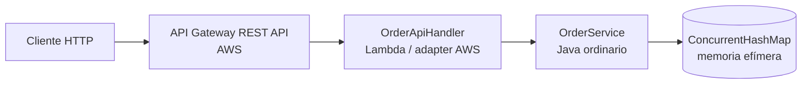

# Orders API — Serverless REST API

Entrega del workshop **Designing a Serverless REST API with AWS Lambda and API Gateway**.

La solución usa Java 17, Maven, AWS Lambda, API Gateway REST API, JUnit 5 y una separación explícita entre lógica de negocio y código específico de AWS.

## Estado de la entrega

| Requisito | Estado | Evidencia |
|---|---|---|
| Contrato REST documentado | Listo | Esta sección y tabla de endpoints |
| Aplicación en Java sin HTTP/AWS | Listo | `domain/` y `application/OrderService.java` |
| Pruebas unitarias | Listo | `mvn test` — 9 pruebas pasan |
| Empaquetado Maven | Listo | `target/orders-api-1.0.0.jar` |
| Lambda Java desplegada | Listo | [test Lambda](docs/08-lambda-test-201.png) |
| API Gateway proxy | Listo | [API Gateway](docs/00-api-gateway-stage.png) |
| POST, GET, búsqueda y DELETE | Listo | Evidencias `docs/01` a `docs/06` |
| Errores 400 y 404 | Listo | Código, pruebas y [404](docs/05-get-not-found-404.png) |
| Arquitectura documentada | Listo | Diagrama incluido abajo |
| Video de demostración | Listo | [evidence.mp4](docs/evidence.mp4) |

## Contrato de la API

| Método | Ruta | Éxito | Errores |
|---|---|---|---|
| `POST` | `/orders` | `201 Created`, orden y header `Location` | `400 Bad Request` |
| `GET` | `/orders/{id}` | `200 OK`, orden | `404 Not Found` |
| `GET` | `/orders?customerId={customerId}` | `200 OK`, arreglo | `400 Bad Request` |
| `DELETE` | `/orders/{id}` | `204 No Content` | `404 Not Found` |

Ejemplo de orden:

```json
{
  "id": "ORD-001",
  "customerId": "CUST-42",
  "product": "MacBook Air",
  "quantity": 1
}
```

Formato de error:

```json
{
  "error": "ORDER_NOT_FOUND",
  "message": "Order ORD-999 does not exist"
}
```

`/orders/{id}` representa un recurso individual. `customerId` es un query parameter porque es un criterio de búsqueda sobre la colección `/orders`. Un POST exitoso devuelve `201 Created` y `Location` porque crea un recurso nuevo. Un recurso inexistente devuelve `404`; una entrada inválida devuelve `400`.

## Arquitectura final



`Order`, `CreateOrderRequest`, las excepciones y `OrderService` no conocen HTTP, API Gateway ni Lambda. `OrderApiHandler` conoce el evento `APIGatewayProxyRequestEvent`, la serialización JSON, las rutas y los códigos HTTP.

## Estructura del proyecto

```text
orders-api/
├── pom.xml
├── template.yaml
├── README.md
├── docs/
│   └── evidencias del despliegue y pruebas
├── events/
│   └── eventos JSON para invocación directa
└── src/
    ├── main/java/com/example/orders/
    │   ├── domain/
    │   ├── application/OrderService.java
    │   └── adapter/
    │       └── OrderApiHandler.java
    └── test/java/com/example/orders/
```

## Implementación y pruebas locales

Requisitos: JDK 17 o superior y Maven 3.9+.

```bash
cd orders-api
mvn test
mvn package
```

Resultado verificado:

```text
Tests run: 9, Failures: 0, Errors: 0
BUILD SUCCESS
```

El JAR sombreado listo para Lambda es:

```text
target/orders-api-1.0.0.jar
```

La lógica se prueba sin AWS, sin servidor web y sin Spring Boot. El JAR contiene las dependencias necesarias de Lambda, eventos AWS y Jackson.

## Lambda y conversión JSON

El runtime de Lambda convierte el evento JSON en `APIGatewayProxyRequestEvent` según la firma `RequestHandler`. La respuesta `APIGatewayProxyResponseEvent` se serializa de vuelta a JSON.

En la integración proxy, API Gateway entrega al handler:

- método HTTP en `httpMethod`;
- ruta en `path`;
- parámetros de ruta en `pathParameters`;
- query parameters en `queryStringParameters`;
- headers en `headers`;
- body como texto en `body`.

Los ejemplos están en `events/`:

- `events/post-order.json`
- `events/get-order.json`
- `events/find-orders.json`
- `events/delete-order.json`

El handler configurado en AWS es:

```text
com.example.orders.adapter.OrderApiHandler::handleRequest
```

## Despliegue con AWS SAM

El archivo `template.yaml` define la Lambda, el API Gateway REST API, permisos, stage y rutas.

```bash
sam build
sam validate --lint
sam deploy --guided
```

Para despliegue manual desde la consola AWS, sube `target/orders-api-1.0.0.jar`, selecciona Java 21 o Java 17, `x86_64` y configura el handler anterior.

La API desplegada para esta entrega es:

```text
https://xiuevz18xk.execute-api.us-east-1.amazonaws.com/prod
```

## Configuración de API Gateway

La estructura desplegada es:

```text
/
└── orders
    └── {id}
```

Métodos:

```text
POST /orders
GET  /orders
GET  /orders/{id}
DELETE /orders/{id}
```

Todos usan la misma Lambda con **Lambda Proxy integration**. No se crea un recurso para `customerId`, porque es un query parameter.

## Pruebas HTTP desplegadas

En PowerShell:

```powershell
$base = "https://xiuevz18xk.execute-api.us-east-1.amazonaws.com/prod"
$body = @{
  customerId = "CUST-42"
  product    = "MacBook Air"
  quantity   = 1
} | ConvertTo-Json -Compress

Invoke-WebRequest -Method POST -Uri "$base/orders" `
  -ContentType "application/json" -Body $body

Invoke-WebRequest -Uri "$base/orders/ORD-001"
Invoke-WebRequest -Uri "$base/orders?customerId=CUST-42"
curl.exe -i "$base/orders/ORD-999"
curl.exe -i -X DELETE "$base/orders/ORD-001"
```

Las evidencias visuales están organizadas en `docs/`:

| Archivo | Evidencia |
|---|---|
| [00-api-gateway-stage.png](docs/00-api-gateway-stage.png) | Stage `prod` y URL pública |
| [01-post-create-201.png](docs/01-post-create-201.png) | POST exitoso: `201 Created` |
| [02-get-order-200.png](docs/02-get-order-200.png) | GET exitoso: `200 OK` |
| [03-search-customer-200.png](docs/03-search-customer-200.png) | Búsqueda con resultados: `200 OK` |
| [04-search-empty-200.png](docs/04-search-empty-200.png) | Búsqueda sin resultados: `200 OK` y `[]` |
| [05-get-not-found-404.png](docs/05-get-not-found-404.png) | GET inexistente: `404 Not Found` |
| [06-delete-204-and-after-404.png](docs/06-delete-204-and-after-404.png) | DELETE `204` y GET posterior `404` |
| [07-lambda-test-event.png](docs/07-lambda-test-event.png) | Evento de prueba directo |
| [08-lambda-test-201.png](docs/08-lambda-test-201.png) | Lambda directa: `201 Created` |

## Integración Lambda Proxy

En la versión desplegada, API Gateway hace el routing y pasa el evento completo a Lambda. El adapter Java extrae los parámetros, valida la entrada, serializa la respuesta y decide los códigos HTTP. Elegí esta opción porque fue la más sencilla de probar y mantener junto al código.

La integración configurada en los cuatro métodos es:

```text
Integration type: Lambda Function
Lambda proxy integration: True
Handler: com.example.orders.adapter.OrderApiHandler::handleRequest
```

## Decisiones tomadas

Durante el desarrollo se usó un asistente de código, pero las decisiones se revisaron y se probaron antes de desplegar.

1. **Una Lambda para todo el recurso:** la escogí para evitar duplicar el adapter. Una Lambda por operación también sería posible, pero exigiría más configuración.
2. **Validación en `OrderService`:** la dejé allí para que funcione igual desde una prueba local, una invocación directa o HTTP.
3. **HTTP en el adapter:** `OrderService` trabaja con órdenes; `OrderApiHandler` se ocupa de API Gateway, JSON y códigos HTTP. Así la lógica principal no depende de AWS.
4. **Memoria en vez de base de datos:** se ajusta al alcance del ejercicio y hace las pruebas simples. No la usaría para datos reales porque Lambda no garantiza conservar la memoria.

También se consideró separar cada operación en una Lambda distinta, pero finalmente se mantuvo una sola función para todo el recurso.

## Predicción y extensión DELETE

Antes de implementar DELETE, la predicción fue:

- cambiar `OrderService` para eliminar por ID;
- agregar tests de eliminación;
- agregar `DELETE /orders/{id}` a API Gateway/SAM;
- no crear otra Lambda;
- devolver `204` desde el adapter cuando elimina;
- devolver `404` si el ID no existe.

La implementación final coincide con esa predicción. `OrderService` decide si existe el recurso y el adapter traduce el resultado a HTTP.

## Persistencia y limitaciones

La colección es intencionalmente in-memory. Lambda puede reciclar el entorno, por lo que un POST y un GET posterior no tienen garantía de compartir los mismos datos. Para producción se reemplazaría el mapa por DynamoDB o un repositorio RDS, sin cambiar el contrato HTTP ni la separación de capas.

## Video de demostración

La secuencia resumida está en [video-commands.txt](docs/video-commands.txt).

El video incluido muestra o debe mostrar, en este orden:

1. `mvn test`.
2. `mvn package`.
3. Invocación directa de Lambda.
4. POST público exitoso.
5. GET público exitoso.
6. Búsqueda por cliente.
7. Respuesta 404.
8. Respuesta 400.
9. DELETE con 204.
10. GET posterior con 404.
11. Diagrama de arquitectura y explicación de Lambda Proxy.

No incluyas tokens, headers `Authorization` ni `X-Amz-Security-Token` en capturas o videos.
